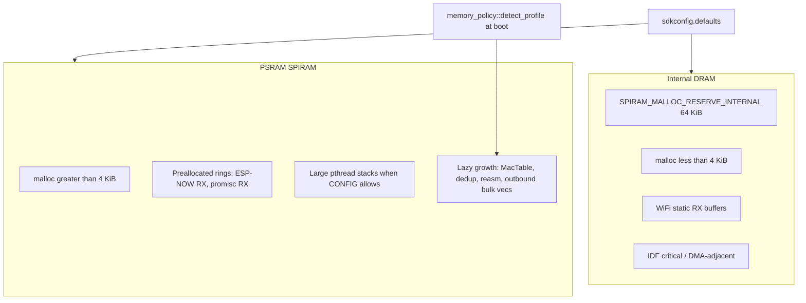

# Memory allocation reference (wolfPACK)

This document maps where RAM goes on wolfPACK firmware at **`PROTO_VERSION` 7`. Legacy PROTO v5/v6 sizing paths are omitted.

**Numeric source of truth:** [`wardriver-shared/src/memory_policy.rs`](../wardriver-shared/src/memory_policy.rs) for runtime caps; [`sdkconfig.defaults`](../sdkconfig.defaults) for IDF / PSRAM integration.

**Related:** transport and peer limits in [`docs/WOLFPACK_PROTOCOL.md`](WOLFPACK_PROTOCOL.md).

---

## Scope and assumptions

| Item | Assumption |
|------|------------|
| Build | `control` or `sniffer` (optional `board-xiao` for pins / buzzer) |
| Hardware | ESP32-C5 class with **8 MiB PSRAM** (N8R8 / Seeed XIAO C5 per `sdkconfig.defaults`); see [`docs/PIN_MAPPING.md`](PIN_MAPPING.md) |
| Boot tiers | `memory_policy::detect_profile()` scales caps from `free_heap_bytes()` / PSRAM presence at boot |
| Control role | GPS, SD / WiGLE CSV, HTTP dashboard, ESP-NOW fleet ingest, peer pool |
| Sniffer role | Promisc / BLE scan, deferred outbound bulk, ESP-NOW uplink only — **no `MacTable`, no geo slots** |

**Out of scope:** host tools, golden fixtures, detailed upload TLS peak (ephemeral heap spike only).

---

## Memory topology

### sdkconfig knobs (`sdkconfig.defaults`)

| Knob | Value | Purpose |
|------|-------|---------|
| `CONFIG_SPIRAM` | y | External RAM enabled |
| `CONFIG_SPIRAM_USE_MALLOC` | y | Unified `malloc`; app uses `alloc` without `heap_caps_*` at most call sites |
| `CONFIG_SPIRAM_MALLOC_ALWAYSINTERNAL` | 4096 | Allocations ≤ 4 KiB stay in internal DRAM |
| `CONFIG_SPIRAM_MALLOC_RESERVE_INTERNAL` | 65536 | Protected internal headroom (not stealable by generic malloc) |
| `CONFIG_SPIRAM_TRY_ALLOCATE_WIFI_LWIP` | y | WiFi / LwIP allocator paths prefer PSRAM |
| `CONFIG_FREERTOS_TASK_CREATE_ALLOW_EXT_MEM` | y | FreeRTOS tasks may use external memory |
| `CONFIG_SPIRAM_ALLOW_STACK_EXTERNAL_MEMORY` | y | Pthread stacks in PSRAM via [`spiram_thread.rs`](../wardriver-shared/src/spiram_thread.rs) |
| `CONFIG_ESP_WIFI_ESPNOW_MAX_ENCRYPT_NUM` | 16 | Hard encrypted-peer cap (peer pool) |
| `CONFIG_ESP_WIFI_STATIC_RX_BUFFER_NUM` | 24 | IDF WiFi static RX pool |
| `CONFIG_ESP_WIFI_DYNAMIC_RX_BUFFER_NUM` | 48 | IDF WiFi dynamic RX pool |
| `CONFIG_ESP_MAIN_TASK_STACK_SIZE` | 32768 | Main task (control loop / sniffer main) |
| `CONFIG_MBEDTLS_DYNAMIC_BUFFER` | y | TLS I/O buffers allocated per connection (upload) |

---

## Runtime tier detection

[`detect_profile()`](../wardriver-shared/src/memory_policy.rs) runs once at boot (sniffer: `load_runtime_policy()`; control: `load_control_runtime_policy()`).

### MAC table + geo (combined budget)

Geo slots are fixed at **5000** on control; sniffer sets `geo_slots_cap = 0` and assigns the full combined byte budget to unused `mac_table_max_entries` fields.

Estimates: `EST_BYTES_PER_MAC_TABLE_ENTRY = 52`, `EST_BYTES_PER_GEO_SLOT = 56`.

| Tier | Condition | Combined budget | ~MAC rows | Geo slots |
|------|-----------|-----------------|-----------|-----------|
| Low | `free_total ≤ 300_000` | 640 KiB | 7,214 | 5,000 (control) / 0 (sniffer) |
| Mid | `free_total > 300_000` | 1.25 MiB | 19,821 | 5,000 / 0 |
| High | PSRAM + `free_total > 1_500_000` | 2.5 MiB | 45,027 | 5,000 / 0 |
| Control PSRAM override | `free_spiram_heap_bytes() > 0` on control | 5 MiB | **95,440** | 5,000 |
| Android enrichment (fixed) | `phone_control_mac_table_limits()` | 5 MiB | **95,440** | 5,000 |

**Worked example (control + PSRAM / phone):** `5 × 1024 × 1024 − 5000 × 56 = 4,962,880` bytes for rows → `4,962,880 / 52 = 95,440` `max_entries`, plus 5000 concurrent `geo_active` rows. Constants and math live in [`wardriver-core/src/ingest_limits.rs`](../wardriver-core/src/ingest_limits.rs).

### Other `RuntimeMemoryPolicy` fields by tier

| Field | Low | Mid | High (PSRAM) | Control PSRAM override |
|-------|-----|-----|--------------|--------------------------|
| `espnow_rx_queue_capacity` (sniffer) | 96 | 128 | 192 | — |
| `promisc_queue_capacity` (sniffer) | ~190 | ~190 | ~190 | — |
| `sd_writer_queue_capacity` | 384 | 512 | 1024 | 128 (then `min(128)` in `apply_control_node_limits`) |
| `dedup_max_entries` | 3072 | 4096 | 8192 | 16,384 |
| `reasm_max_entries` | 96 | 128 | 320 | 512 |
| `control_loop_slice_frames` | 256 | 384 | 512 | 512 |
| `maintenance_items_per_tick` | 64 | 64 | 64 | 64 |
| `row_dedup_heap_trim_bytes` | `free_internal / 4`, clamp 24k–96k | same | same | same |

Control ESP-NOW RX depth is **not** policy-tuned: fixed **256** slots in [`espnow.rs`](../wardriver-shared/src/espnow.rs).

---

## Control role — allocation inventory

### Preallocated SPIRAM (boot, contiguous)

| Name | Cap | ~Bytes | Placement | Growth | Source | Notes |
|------|-----|--------|-----------|--------|--------|-------|
| ESP-NOW RX ring | 256 × 1480 B | ~380 KiB | SPIRAM | Fixed at boot | `ESPNOW_RX_QUEUE_CAPACITY_CONTROL` | `RX_FRAME_SLOT_BYTES = 6 + 1470 + 4`; panic if alloc fails |

### Runtime policy — ingest (`IngestSharedState`)

| Name | Policy field | Cap (PSRAM control) | Placement | Growth | Source | Notes |
|------|--------------|---------------------|-----------|--------|--------|-------|
| Fragment dedup WiFi | `dedup_max_entries` | 16,384 | Heap `IndexMap` | Lazy | `memory_policy.rs` | Separate `dedup_ble` map, same cap |
| Reassembly WiFi / BLE | `reasm_max_entries` | 512 | Heap `HashMap` | Per in-flight batch | `espnow_rx.rs` | WiFi `Vec` reserve uses hidden-SSID worst case (wolfPACK wire) |
| MacTable rows | `mac_table_max_entries` | 95,440 | Heap `IndexMap` | Lazy | `mac_table.rs` | WiGLE + detection lanes; same cap on Android via `phone_control_mac_table_limits()` |
| MacTable geo slots | `mac_table_geo_slots_max` | 5,000 | In-row flag | LRU release | `mac_table.rs` | Revisit throttle; not a separate table |
| Main-loop ESP-NOW drain | `control_loop_slice_frames` | 512 | — | Fixed | `control_workers.rs` | Frames drained per main-loop tick |
| Maintenance prune | `maintenance_items_per_tick` | 64 | — | Fixed | `dedup_maintenance.rs` | LRU evictions per tick |

### Control-only structures (outside `RuntimeMemoryPolicy`)

| Name | Cap | Placement | Source | Notes |
|------|-----|-----------|--------|-------|
| Peer pool | ≤ 16 MACs | Heap `HashMap` | `peer_pool.rs` | Mirrors IDF encrypt peer table |
| Peer join FIFO | 48 entries | Heap `Vec` | `peer_join_queue.rs` | `QUEUE_MAX_ENTRIES` |
| Post-dump sessions | ≤ peer pool | Heap `HashMap` | `peer_pool.rs` | Per-visit timing state |
| Sniffer dashboard table | 48 slots | Static / stats | `sniffer_slots.rs` | `FLEET_MAX_SNIFFERS` |
| Detection alert log | 256 / stack | Heap | `detection_alert_log.rs` | WiFi + BLE stacks |
| Channel plan cache | 1 entry | Heap | `channel_plan_cache.rs` | Cloned schedules on hit |
| SD writer queue | 128 (64 emergency) | Heap queue | `sd_io.rs` | WiGLE row lines |
| SD RPC queue | 8 | Fixed | `SD_IO_RPC_CAPACITY` | Worker RPC depth |

### Pthread / task stacks

| Thread | Stack | PSRAM when available | Source |
|--------|-------|----------------------|--------|
| `espnow-ingest` | 128 KiB → 64 → 32 → 24 → 12 KiB fallbacks | Yes | `spiram_thread::INGEST_STACK_FALLBACKS` |
| `sd-io` | 128 KiB | Yes | `SD_IO_STACK_BYTES` |
| `https-upload` | 28 KiB | Pthread default caps | `boot_setup.rs` `UPLOAD_THREAD_STACK` |
| httpd | 24 KiB | Yes (IDF config) | `web/mod.rs` |
| GPS supervisor | 4 KiB | — | `gps.rs` |
| alert feedback | 16 KiB | — | `alert_feedback.rs` |
| main | 32 KiB | — | `CONFIG_ESP_MAIN_TASK_STACK_SIZE` |

### Ephemeral / session (not centrally budgeted)

- WiGLE CSV row `Vec`s on SD writer queue
- Upload: 32 KiB read chunk + mbedTLS dynamic buffers per HTTPS connection ([`uploader.rs`](../wardriver-control/src/uploader.rs))
- HTTP handler stack buffers, `/api/stats` JSON build on main
- GPS history `VecDeque`

---

## Sniffer role — allocation inventory

### Preallocated SPIRAM rings

| Name | Cap | ~Bytes | Source | Notes |
|------|-----|--------|--------|-------|
| ESP-NOW RX ring | policy `espnow_rx_queue_capacity` (96–192) | slots × 1480 B | `sniffer.rs` boot | `configure_rx_queue_capacity` |
| Promisc RX ring | policy `promisc_queue_capacity` (~190) | 192 KiB (slots × ~1032 B) | `wifi_promisc.rs` | Fixed `PROMISC_QUEUE_BUDGET_BYTES`; `PROMISC_MAX_COPY` 1024 + 8 B metadata |

### Deferred wardrive bulk (sniffer)

| Name | Budget | Placement | Source | Notes |
|------|--------|-----------|--------|-------|
| `OutboundBulkStore` | 64 KiB × 3 (192 KiB total) | SPIRAM vecs | `OUTBOUND_BULK_*_BUDGET_BYTES` | Independent lanes: WiFi ~1,130 APs, probe ~1,986 bursts, BLE ~1,820 entries; per-lane LRU eviction; join pressure at 90% of any lane |

### Sniffer runtime buffers

| Name | Cap | Source | Notes |
|------|-----|--------|-------|
| Per-sweep AP reassembly | `MAX_APS_PER_FRAG_WORST_CASE × 255` (30 × 255 = 7,650 rows) | `sniffer_espnow.rs` | `frag_total` is `u8`; worst case uses max-SSID wire rows per fragment |
| BLE sweep buffer | 512 entries | `ble_sniffer.rs` `MAX_ENTRIES_IN_SWEEP_BUFFER` | Per dwell |
|| `sniffer-led` worker | 6 KiB stack | `sniffer_led.rs` | |

### SSID watch patterns

SSID watch list supports tagged pattern rules alongside exact-match SSIDs:
- **Exact**: plain SSID name (existing behavior)
- **`PREFIX:<prefix>`**: match SSIDs starting with `prefix`
- **`PREFIX_LEN:<prefix>,<len>`**: match SSIDs starting with `prefix` AND exactly `len` chars
- **`CONTAINS:<substring>`**: match SSIDs containing `substring` anywhere

Parsing lives in [`wardriver-core/src/ssid_watch.rs`](../wardriver-core/src/ssid_watch.rs) (pure Rust, host-testable).
Pattern validation mirrors the Rust parser in Android's [`LineListValidators.kt`](../wardriver-android/app/src/main/java/net/wardriver/mobile/data/LineListValidators.kt).

### Not used on sniffer

| Structure | Notes |
|-----------|-------|
| `MacTable` | Not constructed; `mac_table_geo_slots_max = 0` in policy |
| Geo slots | No GPS on sniffer |

### Sniffer probe dedup

- **Structure:** `HashMap<([u8;6], [u8;32], u8), ProbeLogEntry>` in `PromiscCapture`
- **Key:** (source MAC, SSID bytes, SSID length)
- **Max entries:** 512 (LRU eviction by `last_seen_ms`)
- **Per-entry overhead:** ~90 bytes (HashMap node + ProbeLogEntry with last_seen_ms + log_count)
- **Total:** ~46 KiB (within sniffer heap budget)
- **Row cap:** 10 observations per (MAC, SSID) pair
- **Cooldown:** 10 seconds between entries for same (MAC, SSID)

---

## Shared infrastructure

| Mechanism | Role | Source |
|-----------|------|--------|
| `spiram_queue::bounded_channel` | Single contiguous SPIRAM ring for ESP-NOW / promisc RX | `spiram_queue.rs` |
| `spiram_heap::vec_with_capacity` | SPIRAM-first `Vec` prealloc | `spiram_heap.rs` |
| ESP-NOW v2 MTU | 1470 B application payload per frame | `espnow.rs`, `wardriver-proto` |
| `FLEET_MAX_SNIFFERS` | 48 | `fleet.rs` |
| `ESPNOW_MAX_ENCRYPT_PEERS` | 16 | `fleet.rs` / IDF sdkconfig |
| `WIFI_CCMP_KEY_SLOTS` | 17 (1 SoftAP STA + 16 ESP-NOW encrypt) | `fleet.rs` |

---

## Pressure, shrink, and invariants

| Trigger | Effect | Source |
|---------|--------|--------|
| `apply_control_node_limits` | `sd_writer_queue_capacity ≤ 128`, `control_loop_slice_frames ≤ 512` | `memory_policy.rs` |
| `free_internal_heap_bytes() < 120_000` | SD queue ≤ 64, `reasm_max_entries ≤ 64`, `dedup_max_entries ≤ 1024`, slice ≤ 64 | `memory_policy.rs` |
| `maybe_trim_mac_table` | MacTable `shrink_to_cap_fraction(0.5)` when `free_heap_bytes() < max(row_dedup_heap_trim_bytes, 32_000)` **or** `free_internal_heap_bytes() < trim_floor / 2` | `dedup_maintenance.rs` |
| Outbound bulk any lane ≥ 90% of 64 KiB or 60 s undelivered | Sniffer `join_before_dump` pressure | `sniffer_outbound_bulk.rs` |
| Fragment dedup prune floor | `max(dedup_max_entries, 4096)` per map | `dedup_maintenance.rs` `DEDUP_MAX_ENTRIES` |
| ESP-NOW RX queue full | Drop frame; `espnow_rx_dropped_queue_full` | ingest / espnow callback |
| Peer pool at 16 | LRU evict idle peer; blocked if reasm incomplete / visit-arm / post-dump grace | `peer_pool.rs` |
| MacTable at `max_entries` | LRU full-row eviction on new MAC | `mac_table.rs` |
| Geo slots at 5000 | LRU geo release (row stays, `geo_active` cleared) | `mac_table.rs` |

MacTable uniqueness checks are **hash lookups** (`IndexMap::get` by 6-byte MAC), not linear scans over table size.

---

## Observability

Key `/api/stats` fields (see `/diagnostics` for the full JSON set):

| Key | Allocation / behavior |
|-----|---------------------|
| `mac_table_entries`, `mac_table_geo_active` | Current MacTable occupancy |
| `mac_table_max_entries`, `mac_table_geo_slots_max` | Policy caps at boot |
| `mac_table_row_evictions`, `mac_table_geo_releases` | LRU pressure |
| `espnow_rx_queue_inflight`, `espnow_rx_queue_hwm` | Control ESP-NOW ring |
| `sd_writer_queue_inflight`, `sd_writer_queue_hwm` | SD writer backlog |
| `min_free_internal_heap_bytes`, `min_free_spiram_heap_bytes` | Low-water marks |
| `control_mem_heap_*` | Control internal + SPIRAM |
| `sniffers[].mem_heap_*` | Per-sniffer heap from ACK |
| `promisc_rx_dropped_queue_full` | Sniffer promisc ring overflow |
| `control_ingest_stack_bytes` | Chosen `espnow-ingest` stack size |

---

## Agent change checklist

1. Read this doc and [`memory_policy.rs`](../wardriver-shared/src/memory_policy.rs).
2. Prefer **SPIRAM prealloc** for large fixed rings; lazy `IndexMap` / `HashMap` for session-scoped growth.
3. Gate control-only helpers in shared crates with `#[cfg(feature = "control")]`.
4. Update **`docs/MEMORY.md`** in the same change when caps or constants move.
5. Verify: `cargo check` control + sniffer (`cargo check --features "control board-xiao"` then `cargo check --features sniffer`); `cargo test-host` if proto / core touched.
6. On device: watch `min_free_*` and queue HWMs during wardrive soak.

---

## SSID watch patterns (`SsidWatch`)

The sniffer `SsidWatch` holds two structures:
- **`exact: HashSet<String>`** — exact-match SSIDs (unchanged from before patterns). Each entry ~40 bytes heap.
- **`patterns: Vec<SsidWatchRule>`** — tagged pattern rules (`PREFIX:`, `PREFIX_LEN:`, `CONTAINS:`). Each rule is one owned `String` + optional `u8` (~40 bytes heap per pattern rule on ESP32).

Total heap: `exact.len() * 40 + patterns.len() * 40` bytes. Max 32 lines per the app validator.
