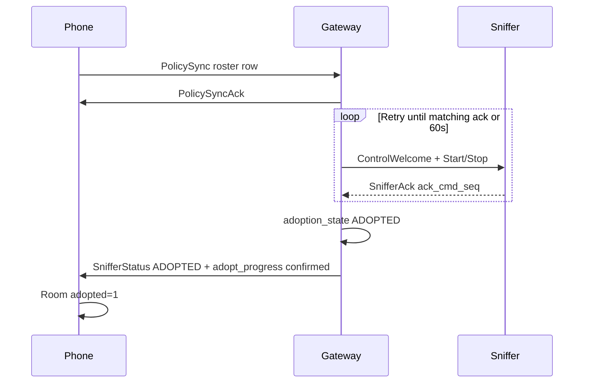

# PackLink protocol

PackLink is the phone ↔ wolfPACK **gateway** frame codec (`PACKLINK_VERSION` 1). Primary transport is SoftAP plaintext TCP; see [PACKLINK_SOFTAP.md](PACKLINK_SOFTAP.md) for Wi-Fi, TOFU session setup, and dual-network UX.

ESP-NOW between gateway/control and sniffers is documented separately in [WOLFPACK_PROTOCOL.md](WOLFPACK_PROTOCOL.md). PackLink never carries the fleet ESP-NOW PMK.

**Codec:** [`wardriver-packlink/src/lib.rs`](../wardriver-packlink/src/lib.rs)

---

## Frame envelope

All messages share a fixed header and CRC32 trailer. Multi-byte integers are little-endian.

| Field | Size | Notes |
|-------|------|-------|
| `magic` | 4 | `PLNK` |
| `version` | 1 | `PACKLINK_VERSION` = 1 |
| `msg_type` | 1 | [`MsgType`](#message-types) |
| `flags` | 1 | See flags below |
| `seq` | 4 | Per-direction sequence (semantics per message) |
| `payload_len` | 2 | Payload byte count |
| `payload` | N | Message-specific |
| `crc32` | 4 | CRC of bytes before trailer |

### Flags

| Bit | Name | Use |
|-----|------|-----|
| 0 | `FRAGMENT` | ObservationBulk fragmentation |
| 1 | `FRAGMENT_END` | Last ObservationBulk fragment |
| 2 | `PRIORITY_ALERT` | EventNotify priority |
| 3 | `SPOOL_REPLAY` | SpoolReplay chunk |

---

## Message types

| Type | Name | Direction | Purpose |
|------|------|-----------|---------|
| 1 | `GatewayInfo` | Gateway → phone | SoftAP identity, versions, spool, peer pool |
| 2 | `PolicySync` | Phone → gateway | Roster, geofence, denylists, channel plan, flock masks |
| 3 | `ControlCmd` | Phone → gateway | Opaque wolfPACK `ControlCmd` broadcast |
| 4 | `EventNotify` | Gateway → phone | Flock / watch / geofence / spool events |
| 5 | `ObservationBulk` | Gateway → phone | Reassembled wardrive batch |
| 6 | `SpoolReplay` | Gateway → phone | Offline spool drain |
| 7 | `TimeSync` | Bidirectional | Wall / mono clock exchange |
| 8 | `SnifferStatus` | Gateway → phone | Live sniffer table + adoption_state |
| 9 | `CaptureCmd` | Phone → gateway | Start RF capture job |
| 10 | `CaptureStatus` | Gateway → phone | Capture progress |
| 11 | `PhoneHello` | Phone → gateway | TOFU phone id |
| 12 | `TrustOk` | Gateway → phone | TOFU accepted |
| 13 | `TrustReject` | Gateway → phone | TOFU rejected |
| 14 | `SoftApConfig` | Phone → gateway | SoftAP credential update |
| 15 | `TrustForget` | Phone → gateway | Clear pinned phone |
| 16 | `PolicySyncAck` | Gateway → phone | Policy apply result |
| 17 | `ChannelPlanSync` | Phone → gateway | Operator channel plan |
| 18 | `ChannelPlanSyncAck` | Gateway → phone | Channel plan apply result |
| 19 | `FleetUnbindNotify` | Gateway → phone | Physical BOOT unbind cleared gateway roster; phone clears Room fleet |
| 20 | `ProbeObservationBulk` | Gateway → phone | Non-wildcard probe request observation batch |

### Request / response pairs

| Request | Response |
|---------|----------|
| `PolicySync` (2) | `PolicySyncAck` (16) — correlate on uplink frame `seq` ↔ `policy_seq` |
| `CaptureCmd` (9) | `CaptureStatus` (10) |
| `PhoneHello` (11) | `TrustOk` (12) or `TrustReject` (13) |
| `TimeSync` (7) | `TimeSync` (7) stamped reply |

---

## Clock model

Gateway mono milliseconds (`stats::now_ms()` / esp_timer) are the domain for:

- `SnifferStatus.last_seen_ms` (per row)
- `SnifferStatus` batch header `gateway_mono_ms`
- `TimeSync.gateway_mono_ms` on **gateway → phone** replies

**Phone uplink TimeSync** sets `gateway_mono_ms = 0`. The gateway echoes the request payload but **writes `gateway_mono_ms = now_ms()`** before packing the reply.

**Phone extrapolation:** on each TimeSync reply or SnifferStatus batch, store `(gateway_mono_ms, wall_clock)`. Between updates:

`gateway_now = gateway_mono_ms + (wall_now - wall_at_anchor)`

Do **not** use `max(last_seen_ms)` of sniffer rows as a clock — that freezes relative “seen ago” when a batch of stale last-seen values repeats.

Control-node dashboards use `/api/stats` `now_ms` the same way for stale / last-seen labels (`SNIFFER_QUIET_STALE_MS` = 20 s).

---

## SnifferStatus (type 8)

Periodic SoftAP notify (~2 s while phone connected).

### Payload

```
gateway_mono_ms(4) | count(1) | rows[count × 22]
```

### Per-row (22 bytes)

| Offset | Field | Notes |
|--------|-------|-------|
| 0 | `sniffer_id` u32 | |
| 4 | `mac` [6] | |
| 10 | `last_seen_ms` u32 | Gateway mono |
| 14 | `state` u8 | wolfPACK sniffer state |
| 15 | `role` u8 | 0 WiFi, 1 BLE |
| 16 | `cpu_load_pct` u8 | |
| 17 | `heap_avail_pct` u8 | |
| 18 | `fleet_slot` u8 | |
| 19 | `reboot_count` u16 | |
| 21 | `adoption_state` u8 | See below |

### `adoption_state` (aligned with control `SnifferSlot`)

| Value | Name | Meaning |
|-------|------|---------|
| 0 | Empty | Unused / unknown |
| 1 | Pending | Seen on air; not roster-bound |
| 2 | Adopted | Roster match + welcome path complete |
| 3 | Removed | Removed from roster |

Gateway builds rows from `stats::for_each_sniffer_slot` including `adoption_state`. Adopted binding still requires an ESP-NOW `SnifferHello` / peer-join path with roster match (see [Adoption lifecycle](#adoption-lifecycle)).

---

## PolicySync (type 2) and PolicySyncAck (type 16)

### PolicySync

Phone-owned fleet policy. Remains **phone → gateway only**.

Frame `seq` must be a **monotonic uplink sequence** chosen by the phone. The gateway correlator copies that value into `PolicySyncAck.policy_seq`. Legacy `pack_policy_sync` defaults `seq = 0`; phone code uses `pack_policy_sync_seq` / JNI `seq` JSON field.

Payload includes scan/wardrive flags, geofence, denylists, roster (`sniffer_id`, `mac`, `fleet_slot`, `role`), channel schedule, flock masks, SSID watch, and optional trailing `remote_id_disable_mask` (`u32`, little-endian) followed by `ble_active_scan` (`u8`, `1` = BLE-role sniffers use active LE scan / SCAN_REQ, `0` = passive). Legacy phones omit these trailing fields; unpack defaults `remote_id_disable_mask` to `0` (all Remote ID methods enabled) and `ble_active_scan` to `0` (passive).

Applying a PolicySync:

1. Updates RAM policy on the gateway.
2. Arms the gateway adoption-retry FSM for roster entries (does **not** set `adoption_state = ADOPTED` until `SnifferAck` confirms).
3. Broadcasts denylists / watch / schedule commands.
4. Sends `PolicySyncAck`.

### PolicySyncAck payload

```
policy_seq(4) | result(1) | error_code(1)
```

| `result` | Meaning |
|----------|---------|
| 0 | Applied OK |
| 1 | Rejected / apply failed |

| `error_code` | Meaning |
|--------------|---------|
| 0 | None |
| 1 | Parse / unpack failure |
| 2 | Apply failed (downlink / roster error) |

Frame `seq` on the ack is the gateway notify counter (independent). Phone matches **`policy_seq`**.

Ack confirms gateway RAM roster + welcome queue only. **Fleet UI promotion still waits** for `SnifferStatus.adoption_state == ADOPTED`.

---

### Optional extension tails

When any row carries channel-plan fields, the batch appends extension version `1` and 8 bytes per row (see [`channel_plan_sync.rs`](../wardriver-packlink/src/channel_plan_sync.rs)).

When any row carries gateway adoption-retry progress, the batch appends extension version `2` and 2 bytes per row:

| Offset | Field | Values |
|--------|-------|--------|
| 0 | `adopt_progress` u8 | `0` none, `1` waiting policy, `2` retrying welcome, `3` confirmed, `4` timed out (hello live), `5` timed out (no hello) |
| 1 | `adopt_reason` u8 | `0` none, `1` send failed, `2` possible existing binding, `3` roster removed |

The gateway cannot identify a foreign gateway MAC on the current sniffer wire format. `adopt_reason = 2` means Hellos continue without a matching `SnifferAck` — remove the sniffer from the old gateway roster or clear NVS.

---

## Adoption lifecycle



Gateway confirmation uses the existing `SnifferAck.ack_cmd_seq` echo from the follow-on Start/Stop after `ControlWelcome`. A roster-matching `SnifferHello` enqueues the same deferred welcome path as the control node, schedules an FSM-aware retry, and refreshes liveness while `adoption_state` stays Pending until that ack arrives.

### Phone state machine (Room `fleet_roster`)

| `adopted` | `adopt_pending` | UI | In PolicySync roster |
|-----------|-----------------|----|----------------------|
| 0 | 0 | Nearby (live status) | No |
| 0 | 1 | Adopting | Yes |
| 1 | 0 | Fleet | Yes |

Promotion: on each `SnifferStatus` batch, for `adopt_pending` rows, when `adoption_state == ADOPTED` and both `sniffer_id` and normalized MAC match the Room row, set `adopted=1`, `adopt_pending=0`.

### Android sniffer IDs (wire `u32`)

Room and UI store sniffer IDs as signed 32-bit integers (FNV-derived `u32` values). PolicySync and ChannelPlanSync JSON must serialize every `sniffer_id` as an unsigned wire value (`id.toLong() and 0xFFFF_FFFFL`) so high-bit IDs (`0x80000000`–`0xFFFFFFFF`) pack successfully. JNI rejects negative JSON numbers; a single negative roster entry makes the entire PolicySync pack fail. `PolicyPushResult` reports pack failure, TCP write failure, superseded enqueue, stale session, or successful **TCP write** (`Pushed`). PackLink `PolicySyncAck` remains a separate application acknowledgement after the gateway applies policy.

### Nearby expiry

Unadopted Nearby cards (not in Fleet or Adopting) expire after **20 seconds** without gateway-relative liveness: `gatewayNowMs - lastSeenMs >= 20_000` while connected. The Sniffers screen recomputes this filter on the one-second gateway clock tick and on each status batch. Adopted and actively adopting cards keep their existing stale/failure presentation.

### Gateway adoption FSM (delayed ack)

The gateway keeps the **earliest** outstanding `expected_ack_cmd_seq` across welcome retries. A delayed `SnifferAck` for that sequence or any wrap-safe newer `ack_cmd_seq` confirms adoption. A later send failure does not clear the outstanding sequence. Idempotent PolicySync re-arm for an unchanged `(sniffer_id, MAC, fleet_slot)` preserves retry state; identity or slot change, or explicit re-arm after timeout, resets it. Phone reconnect PolicySync must not disturb confirmed wolfPACK bindings (see [WOLFPACK_PROTOCOL.md](WOLFPACK_PROTOCOL.md) PackLink vs wolfPACK sessions). Retry spacing after each attempt is 250 ms, 500 ms, 1 s, 2 s, then 5 s. Hello-triggered welcomes, role/policy deferred welcomes, and timed FSM retries share one bounded welcome queue (two attempts per fleet tick, recent Hello first).

Pending FSM entries without a stats slot appear as synthetic `SnifferStatus` rows (`last_seen_ms = 0`, `adoption_state = PENDING`, adopt tail populated). Under notify backpressure, queued `SnifferStatus` frames coalesce to the newest snapshot. `hello_welcome` fails before send when encrypted peer install fails.

The Adopting card reads `adopt_progress` / `adopt_reason` for retry status. After gateway retry timeout (`adopt_progress` 4 or 5), the card shows a stable failed state with **Retry** (resends PolicySync and re-arms gateway retries) and **Cancel** (roster removal). The phone automatically resends PolicySync up to three times when `PolicySyncAck` is missing.

### Control-node parity

Control `POST /sniffers/adopt` is **optimistic** (`set_adoption_adopted` immediately after NVS roster write). Phone SoftAP path is **sniffer-bound** for Fleet promotion. Both use the same `adoption_state` enum; control exposes it on `/api/stats`, gateway on PackLink `SnifferStatus`.

ESP-NOW welcome / hello details: [WOLFPACK_PROTOCOL.md](WOLFPACK_PROTOCOL.md) (`ControlWelcome`, `SnifferHello`).

---

## TimeSync (type 7)

Payload (20 bytes):

```
phone_unix_ms(8) | phone_mono_ms(4) | gateway_mono_ms(4) | time_set_seq(4)
```

Used before PolicySync on connect / wardrive start so the gateway can piggyback wall time and the phone can anchor `gateway_mono_ms`.

---

## EventNotify (type 4)

Gateway → phone realtime alerts. Nested payload is an opaque wolfPACK ESP-NOW frame (Flock, SSID watch, Remote ID, etc.).

### Payload header

```
event_kind(1) | sniffer_id(4) | unix_ms(8) | payload_len(2) | nested_payload(N)
```

### `event_kind`

| Value | Name | `PRIORITY_ALERT` |
|-------|------|------------------|
| 1 | `FLOCK_WIFI` | yes |
| 2 | `FLOCK_BLE` | yes |
| 3 | `SSID_WATCH` | yes |
| 4 | `GEOFENCE_LEAVE` | no |
| 5 | `SPOOL_WATERMARK` | no |
| 6 | `GATEWAY_RESET` | no |
| 7 | `REMOTE_ID` | yes |

Priority frames bypass bulk observation backpressure when the phone is connected.

---

## Other payloads (summary)

| Message | Notes |
|---------|-------|
| `GatewayInfo` | MAC, firmware, packlink/proto versions, spool bytes, peer slots, fleet/boot ids |
| `ObservationBulk` | Header + opaque reassembled wolfPACK batch |
| `ProbeObservationBulk` | batch_id(4) + sniffer_id(4) + scan_end_unix_ms(8) + scan_end_ms(4) + count(2) + payload (41 bytes per ProbeObservationWire entry) |
| `SpoolReplay` | Chunked offline drain (`SPOOL_REPLAY` flag) |
| `EventNotify` | `event_kind` + sniffer_id + unix_ms + nested alert payload |
| `CaptureCmd` / `CaptureStatus` | WiFi probe capture job progress |
| TOFU 11–15 | SoftAP trust pin; see SoftAP doc |

---

## Implementation map

| Layer | Path |
|-------|------|
| Codec | [`wardriver-packlink/src/lib.rs`](../wardriver-packlink/src/lib.rs) |
| Gateway TCP I/O, status notify, PolicySyncAck, TimeSync stamp | [`wardriver-gateway/src/softap_transport.rs`](../wardriver-gateway/src/softap_transport.rs) |
| Policy apply + welcome enqueue | [`wardriver-gateway/src/policy_downlink.rs`](../wardriver-gateway/src/policy_downlink.rs) |
| Adoption retry FSM | [`wardriver-gateway/src/gateway_adoption.rs`](../wardriver-gateway/src/gateway_adoption.rs), [`wardriver-gateway/src/adoption_retry.rs`](../wardriver-gateway/src/adoption_retry.rs) |
| Hello / adoption_state | [`wardriver-fleet-realtime/src/sniffer_ingress.rs`](../wardriver-fleet-realtime/src/sniffer_ingress.rs), [`wardriver-gateway/src/gateway_ingress.rs`](../wardriver-gateway/src/gateway_ingress.rs) |
| Stats slots | [`wardriver-stats/src/alerts/sniffer_slots.rs`](../wardriver-stats/src/alerts/sniffer_slots.rs) |
| JNI unpack / pack | [`wardriver-mobile-core/src/jni_enrich.rs`](../wardriver-mobile-core/src/jni_enrich.rs) |
| Android SoftAP + clock | [`GatewayWifiRepository.kt`](../wardriver-android/app/src/main/java/net/wardriver/mobile/data/GatewayWifiRepository.kt) |
| Android roster FSM | [`FleetRepository.kt`](../wardriver-android/app/src/main/java/net/wardriver/mobile/data/FleetRepository.kt) |
| Policy assemble | [`PolicySyncAssembler.kt`](../wardriver-android/app/src/main/java/net/wardriver/mobile/data/PolicySyncAssembler.kt) |

### Host tests

```bash
cargo test -p wardriver-packlink --target x86_64-unknown-linux-gnu
cargo test -p wardriver-mobile-core --target x86_64-unknown-linux-gnu
```
