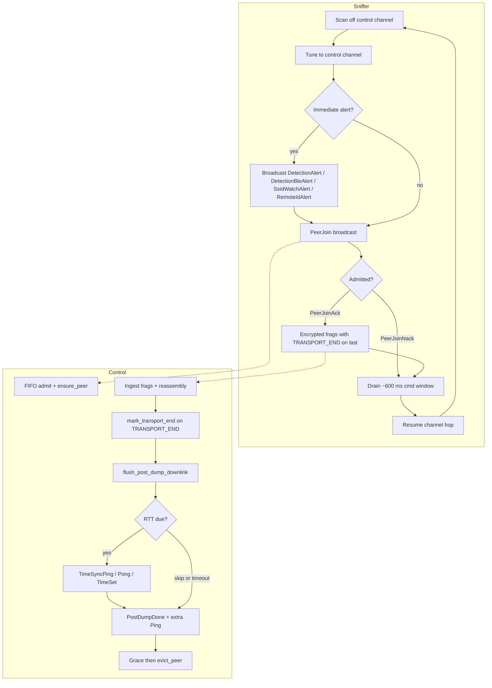
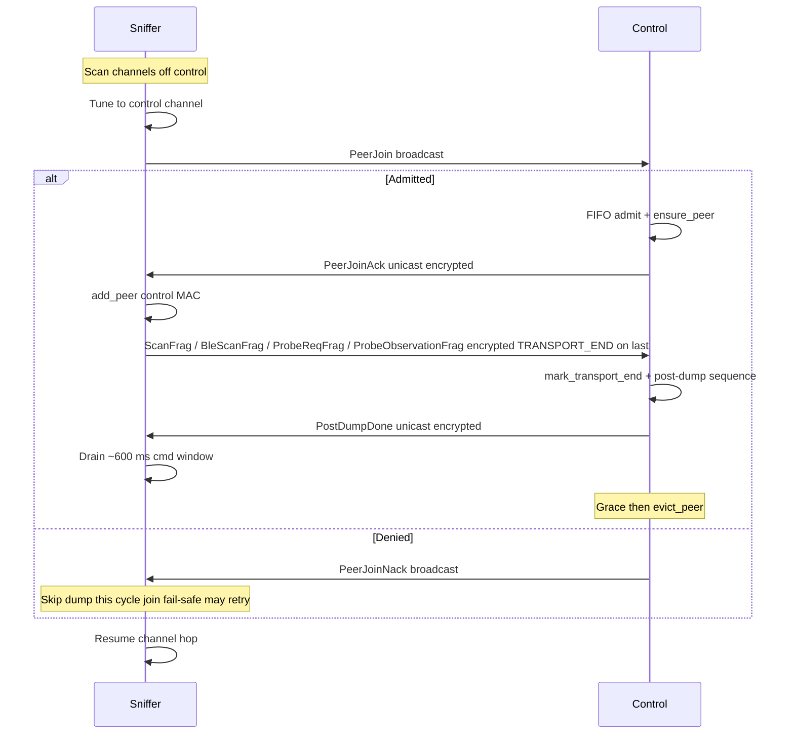
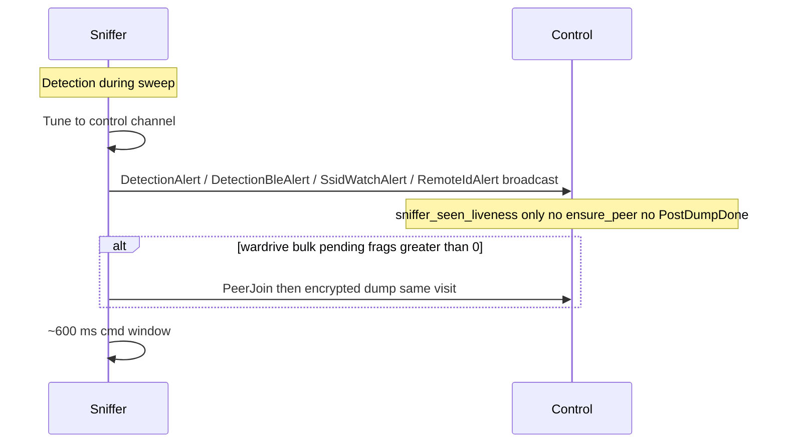

# wolfPACK protocol

wolfPACK is the ESP-NOW wardrive transport layer at `PROTO_VERSION` 8. It time-multiplexes **encrypted** dump visits across a roster larger than the ESP-IDF encrypted-peer limit.

**Code map:** `wardriver-fleet-realtime/src/sniffer_ingress.rs`, `wardriver-fleet-realtime/src/frame_router.rs`, `wardriver-control/src/control/peer_pool.rs`, `wardriver-control/src/control/ingress_sniffer.rs`, `wardriver-control/src/control/ingress_detection_alert.rs`, `wardriver-control/src/control/ingress_detection_ble_alert.rs`, `wardriver-control/src/control/ingress_ssid_watch.rs`, `wardriver-control/src/control/time_sync_rtt.rs`, `wardriver-control/src/control/control_workers.rs`, `wardriver-gateway/src/espnow_bridge.rs`, `wardriver-sniffer/src/sniffer_dispatch.rs`, `wardriver-sniffer/src/sniffer_sweep.rs`, `wardriver-sniffer/src/sniffer_ble.rs`, `wardriver-core/src/peer_join_queue.rs`, `wardriver-core/src/scan_reasm.rs`, `wardriver-core/src/wolfpack_telemetry.rs`, `wardriver-proto/src/lib.rs` (frame types 19–22).

---

## Problem and constraints

| Limit | Value | Meaning |
|-------|-------|---------|
| ESP-NOW v2 MTU | 1470 B | Application payload per `esp_now_send()` (`ESP_NOW_MAX_DATA_LEN_V2`) |
| Per-frame pack budget | 1460 B | Conservative headroom under MTU (`ESP_NOW_FRAME_PAYLOAD_BUDGET`) |
| `ESPNOW_MAX_ENCRYPT_PEERS` | 16 | Concurrent encrypted ESP-NOW peers (IDF `CONFIG_ESP_WIFI_ESPNOW_MAX_ENCRYPT_NUM`) |
| `FLEET_MAX_SNIFFERS` | 48 | Adopted sniffers on the NVS roster and dashboard |
| `WIFI_CCMP_KEY_SLOTS` | 17 | Shared CCMP key budget (SoftAP STA + ESP-NOW encrypt peers) |
| Control ESP-NOW RX ring | 256 slots | Preallocated SPIRAM ring (~380 KiB at v2 MTU) |

**Memory:** heap budgets, tier caps, pthread stacks, and pressure behavior are documented in [`docs/MEMORY.md`](MEMORY.md).

**Protocol version:** `PROTO_VERSION` 8 with wolfPACK peer rotation and Remote ID alerts. Control and sniffers must flash together at the same protocol version.

### Proto cleanup candidates

Fields retained for wire compatibility at v6 but redundant with another field. Remove on the next `PROTO_VERSION` bump.

| Frame | Field | Notes |
|-------|-------|-------|
| `SnifferHello` | `dfs_capable(1)` | Mirrors `five_ghz_capable`; sniffer TX sets both equal; control does not use a separate DFS capability for channel planning. |
| `SnifferAck` | `dfs_capable(1)` | Same as Hello. |
| Control stats / dashboard | `dfs_capable` on sniffer slots | Derived copy of the ACK field; drops with the wire field. |

Frame lengths shrink by 1 B each when removed (`SnifferHello` 24→23, `SnifferAck` 43→42). Trailing fields shift (`proto_min` / `proto_max` in Hello; `bulk_lost_cycles` in Ack).

**Roster vs peer table:** The adopted roster can hold up to 48 sniffers, but the IDF encrypted-peer table holds only 16. wolfPACK rotates sniffers through encrypted slots: admit for a dump burst, finish the post-dump sequence, evict, repeat. The control node keeps **one** SoftAP STA slot for operators; sniffers use ESP-NOW only and do not associate to the SoftAP.

**Roster entry shapes (wire vs persistence):** The same adopted-sniffer idea appears in two forms. `RosterEntryV1` (`wardriver-packlink`) is the **phone-wire** view — what the app sends over PackLink `policy_sync` — and carries an extra `role` byte (`0` WiFi, `1` BLE) because the phone chooses the sniffer role at adoption. `FleetRosterEntry` (`wardriver-core`) is the **persistence** view — the NVS `fleet_roster` blob — and stores `sniffer_id` + `mac` + `fleet_slot` (the `role` is not part of the on-disk roster; it rides on the `policy_sync` wire frame). They are not two sources of truth: the phone wire entry is decoded and projected onto the persistence entry, and the `FLEET_MAX_SNIFFERS` cap (48) is defined once in `wardriver-core` and re-exported by `wardriver-stats`.

**Fragmentation:** Wardrive bulk frames greedy-pack entries up to the byte budget. No AP row is split across frames. Hidden SSIDs (`ssid_len = 0`) cost 14 bytes per AP on the wire instead of 46 (32-byte SSID).

### Encryption model

| Traffic class | Encryption | Peer slot required |
|---------------|------------|-------------------|
| Broadcast discovery and **immediate alerts** (`SnifferHello`, `PeerJoin`, `PeerJoinNack`, `ControlCmd::Ping`, denylists, `DetectionAlert`, `DetectionBleAlert`, `SsidWatchAlert`, `RemoteIdAlert`) | No | No |
| Encrypted unicast (`ScanFrag`, `BleScanFrag`, `ProbeReqFrag`, `ProbeObservationFrag`, `SnifferAck`, `PeerJoinAck`, `ControlWelcome`, `PostDumpDone`, `TimeSet`, `TimeSyncPing`, …) | Yes (fleet PMK) | Yes on **both** ends for reliable TX/RX |

**Control** tracks encrypted peers in `peer_pool` (≤ 16). **Sniffers** hold a single encrypted peer entry for the bound control MAC after `PeerJoinAck` or `ControlWelcome`.

After control calls `evict_peer` (`esp_now_del_peer`), it may not decrypt further encrypted uplink from that MAC until the sniffer is re-admitted via a successful `PeerJoin` → `ensure_peer`. Broadcast `PeerJoin` remains the lightweight liveness and re-admission path. **Immediate alerts** use broadcast and remain deliverable even when the encrypted peer slot is evicted.

**Security:** Broadcast frames (`PeerJoin`, alerts, `Ping`) are visible on-air; fleet PMK encrypts unicast wardrive traffic only (ESP-IDF model).

---

## Messages

All frames share a common header. Multi-byte integers are little-endian unless noted.

### Common header (all frames)

- **Wire:** `proto_version(1) | frame_type(1) | magic(4) | fleet_key(4)`
- **Total:** 10 B
- **Notes:** `proto_version = 6`; `magic = "WDRV"`; `fleet_key = 0x32574452` ("RDW2")

### Discovery

#### `SnifferHello`

- **Direction:** sniffer → broadcast
- **Encryption:** none
- **Purpose:** Identity, capabilities, and `sniffer_boot_id` for fast pairing / recovery.
- **Wire:** `sniffer_id(4) | sniffer_boot_id(4) | role(1) | ble_capable(1) | five_ghz_capable(1) | dfs_capable(1) | proto_min(1) | proto_max(1)`
- **Total:** common(10) + 14 = **24 B**
- **Notes:** `dfs_capable` is a PROTO cleanup candidate; it mirrors `five_ghz_capable` (see Proto cleanup candidates).

#### `ControlWelcome`

- **Direction:** control → unicast
- **Encryption:** yes
- **Purpose:** Bind control MAC, bootstrap schedule, `control_boot_id`, detection masks, home-zone flag.
- **Wire:** `control_boot_id(4) | control_channel(1) | desired_scanning(1) | dwell_ms(2) | chan_count(1) | channels(32) | proto_min(1) | proto_max(1) | detection_disable_wifi_mask(4) | wardrive_suppressed(1) | fleet_slot(1) | detection_disable_ble_mask(4) | remote_id_disable_mask(4) | ble_active_scan(1)`
- **Total:** common(10) + 57 = **67 B**
- **Notes:** `channels` is a fixed 32-byte array; only the first `chan_count` entries are used.

### wolfPACK session

#### `PeerJoin`

- **Direction:** sniffer → broadcast
- **Encryption:** none
- **Purpose:** Request encrypted peer slot before dump frags or scan-only refresh.
- **Wire:** `sniffer_id(4) | sniffer_boot_id(4) | join_reason(1)`
- **Total:** common(10) + 9 = **19 B**
- **Notes:** `join_reason`: `0` DumpWifi, `1` DumpBle, `2` DumpProbe, `3` DetectionAlert (**reserved — do not send**; detection uses broadcast alert frames), `4` PeerRefresh, `5` RemoteIdAlert. Sniffers with pending `ProbeObservationFrag` data use `join_reason = 2` (DumpProbe) when requesting admission.

#### `PeerJoinAck`

- **Direction:** control → unicast
- **Encryption:** yes
- **Purpose:** Admit sniffer: peer slot ready; carries roster slot and epoch.
- **Wire:** `sniffer_id(4) | fleet_slot(1) | peer_epoch(4)`
- **Total:** common(10) + 9 = **19 B**

#### `PeerJoinNack`

- **Direction:** control → broadcast
- **Encryption:** none
- **Purpose:** Deny admission (cap full or FIFO not your turn); targeted by `sniffer_id`.
- **Wire:** `sniffer_id(4) | reason(1) | retry_after_ms(2) | queue_position(1)`
- **Total:** common(10) + 8 = **18 B**
- **Notes:** `reason`: `0` CapFull, `1` NotYourTurn. `queue_position`: `1` = FIFO head, `2+` = depth behind head.

#### `PostDumpDone`

- **Direction:** control → unicast
- **Encryption:** yes
- **Purpose:** Dump cycle complete; sniffer may leave control channel.
- **Wire:** `sniffer_id(4) | session_seq(4) | control_tx_ms(4)`
- **Total:** common(10) + 12 = **22 B**

### Wardrive bulk

Frag headers share the same prefix on `ScanFrag`, `BleScanFrag`, `ProbeReqFrag`, and `ProbeObservationFrag`. The count byte is `ap_count` (WiFi), `entry_count` (BLE / probe).

#### Frag header (shared)

- **Wire:** `flags(1) | sniffer_id(4) | seq(4) | scan_batch_id(4) | sniffer_boot_id(4) | sniffer_scan_end_ms(4) | sniffer_scan_end_unix_ms(8) | frag_idx(1) | frag_total(1) | count(1)`
- **Total:** common(10) + 37 = **47 B**
- **Notes:** `FRAG_FLAG_TRANSPORT_END = 0x01` on exactly one frame per control-channel transport burst (one dump visit), not per reassembly group.

#### `ScanFrag`

- **Direction:** sniffer → control
- **Encryption:** yes
- **Purpose:** Fragmented WiFi AP observations for wardrive CSV.
- **Wire:** frag header + `ap_count` × AP row
- **AP row:** `bssid(6) | channel(1) | rssi(1) | auth(1) | ssid_len(1) | ssid[ssid_len] | obs_mono_ms(4)`
- **Max frame:** 1460 B total (`SCAN_FRAG_MAX_PAYLOAD`)

#### `BleScanFrag`

- **Direction:** sniffer → control
- **Encryption:** yes
- **Purpose:** Fragmented BLE observation batch.
- **Wire:** frag header + `entry_count` × BLE row
- **BLE row:** `addr(6) | rssi(1) | addr_type(1) | company_id(2) | name(22) | obs_mono_ms(4)` — **36 B** per entry
- **Max frame:** 1460 B total

#### `ProbeReqFrag`

- **Direction:** sniffer → control
- **Encryption:** yes
- **Purpose:** Wildcard probe-burst telemetry for MACs that raised `DetectionAlert` since boot.
- **Wire:** frag header + `entry_count` × probe row
- **Probe row:** `src(6) | wildcard_count(1) | channel(1) | rssi_min(1) | rssi_max(1) | rssi_avg_q8(2) | first_seen_ms32(4) | last_seen_ms32(4) | primary_sig_matched(1)` — **21 B** per entry
- **Max frame:** 1460 B total

#### `ProbeObservationFrag`

- **Direction:** sniffer → control (via gateway or direct)
- **Encryption:** yes
- **Purpose:** Non-wildcard probe request observations carrying SSIDs for hidden network discovery.
- **Wire:** frag header (28B) + `entry_count` × probe row
- **Probe row:** `src(6) | ssid_len(1) | ssid[32] | channel(1) | rssi(1)` — **41 B** per entry
- **Max entries per frame:** 34 (1460B total budget)

### Keepalive

#### `ControlCmd`

- **Direction:** control → broadcast or unicast
- **Encryption:** none
- **Purpose:** Start/stop scanning, channel schedule (unicast/full body), ~300 ms `Ping` keepalive, role changes.
- **Wire (full body):** `cmd(1) | cmd_seq(4) | control_channel(1) | dwell_ms(2) | chan_count(1) | channels(32) | desired_role(1) | control_boot_id(4) | detection_disable_wifi_mask(4) | wardrive_suppressed(1) | time_set_seq(4) | ctrl_unix_ms(8) | detection_disable_ble_mask(4) | desired_scanning(1) | peer_slots_free(1) | peer_join_waiters(1) | remote_id_disable_mask(4) | ble_active_scan(1)`
- **Total (full):** common(10) + 75 = **85 B** — used for `StopScanning`, `StartScanning`, `SetChannelSchedule`, `SetRole` only.
- **`Ping` short form (PROTO v8):** `cmd(1)=3 | cmd_seq(4) | control_channel(1) | control_boot_id(4) | detection_disable_wifi_mask(4) | wardrive_suppressed(1) | time_set_seq(4) | ctrl_unix_ms(8) | detection_disable_ble_mask(4) | desired_scanning(1) | peer_slots_free(1) | peer_join_waiters(1) | remote_id_disable_mask(4) | ble_active_scan(1)` → common(10) + 39 = **49 B**. `Ping` does **not** carry dwell or hop channels; sniffers use firmware default (1/6/11) until `ControlWelcome` or unicast `SetChannelSchedule`. `ble_active_scan` is `1` when BLE-role sniffers use active LE scan (SCAN_REQ), else `0` (passive).
- **Notes:** `cmd`: `0` Stop, `1` Start, `2` SetChannelSchedule, `3` Ping, `4` SetRole. `peer_slots_free` / `peer_join_waiters` are populated on broadcast `Ping` only. Optional GPS time piggyback when `time_set_seq != 0`. **`ReleaseBinding` short form:** `cmd(1)=6 | release_epoch(4)` → common(10) + 5 = **15 B**. Gateway sends `ReleaseBinding` only for roster removal, physical fleet unbind, or roster identity change (MAC / `fleet_slot`); PackLink TCP disconnect or reconnect does not trigger release.

#### `SnifferAck`

- **Direction:** sniffer → control
- **Encryption:** yes
- **Purpose:** Heartbeat after handling a command; carries health telemetry.
- **Wire:** `sniffer_id(4) | ack_cmd_seq(4) | state(1) | role(1) | ble_capable(1) | sniffer_boot_id(4) | free_heap_bytes(4) | total_heap_bytes(4) | cpu_load_pct(1) | five_ghz_capable(1) | dfs_capable(1) | bulk_lost_cycles(4)`
- **Total:** common(10) + 33 = **43 B**
- **Notes:** `dfs_capable` is a PROTO cleanup candidate; it mirrors `five_ghz_capable` (see Proto cleanup candidates).

### Immediate alerts

Broadcast fast path; never enter the encrypted peer pool or FIFO join queue by themselves.

#### `DetectionAlert`

- **Direction:** sniffer → broadcast
- **Encryption:** none
- **Purpose:** WiFi LPR-camera detection (immediate).
- **Wire:** `sniffer_id(4) | seq(4) | sniffer_boot_id(4) | sniffer_scan_end_ms(4) | sniffer_scan_end_unix_ms(8) | src(6) | detection_method(1) | channel(1) | rssi_min(1) | rssi_max(1) | rssi_avg_q8(2) | wildcard_count(1) | first_seen_ms32(4) | last_seen_ms32(4) | primary_sig_matched(1)`
- **Total:** common(10) + 46 = **56 B**

#### `DetectionBleAlert`

- **Direction:** sniffer → broadcast
- **Encryption:** none
- **Purpose:** BLE LPR-camera / mobile surveillance detection (immediate).
- **Wire:** `sniffer_id(4) | seq(4) | sniffer_boot_id(4) | sniffer_scan_end_ms(4) | sniffer_scan_end_unix_ms(8) | src(6) | detection_method(1) | company_id(2) | rssi(1)`
- **Total:** common(10) + 32 = **42 B**

#### `SsidWatchAlert`

- **Direction:** sniffer → broadcast
- **Encryption:** none
- **Purpose:** SSID watchlist beacon hit (immediate).
- **Wire:** `sniffer_id(4) | sniffer_boot_id(4) | channel(1) | rssi(1) | bssid(6) | ssid_len(1) | ssid[ssid_len]`
- **Total:** common(10) + 17 + `ssid_len` (variable; max 32-byte SSID)

#### `RemoteIdAlert`

- **Direction:** sniffer → broadcast
- **Encryption:** none
- **Purpose:** OpenDroneID / ASTM F3411 UAS detection (immediate).
- **Wire:** prefix `sniffer_id(4) | seq(4) | sniffer_boot_id(4) | sniffer_scan_end_ms(4) | sniffer_scan_end_unix_ms(8) | src(6) | channel(1) | rssi(1) | detection_method(1) | signal_kind(1) | uas_id(20) | drone_lat_e7(4) | drone_lon_e7(4) | alt_geo_dm(2) | heading_deg(2) | speed_h_dmps(2) | operator_lat_e7(4) | operator_lon_e7(4) | flags(1)` (**77 B**). Optional tail (current sniffers always emit): `id_type(1) | ua_type(1) | status(1) | height_agl_dm(2) | height_type(1) | accuracy(3) | timestamp_ds(2) | operator_location_type(1) | operator_id_type(1) | operator_id(20)` (**33 B**). Short frames without the tail unpack with tail fields zeroed.
- **Total:** common(10) + 77 = **87 B** (legacy); common(10) + 110 = **120 B** (with tail)

### Time sync

#### `TimeSyncPing`

- **Direction:** control → unicast
- **Encryption:** yes
- **Purpose:** RTT time-sync round-trip start (post-dump when due).
- **Wire:** `seq(4) | ctrl_tx_ms(4)`
- **Total:** common(10) + 8 = **18 B**

#### `TimeSyncPong`

- **Direction:** sniffer → control
- **Encryption:** yes
- **Purpose:** RTT time-sync reply.
- **Wire:** `seq(4) | sniff_rx_ms(4) | sniffer_id(4)`
- **Total:** common(10) + 12 = **22 B**

#### `TimeSet`

- **Direction:** control → unicast (standalone or piggybacked on `ControlCmd`)
- **Encryption:** yes
- **Purpose:** GPS-derived Unix ms when wall clock is trusted.
- **Wire:** `seq(4) | ctrl_unix_ms(8) | ctrl_tx_mono_ms32(4)`
- **Total:** common(10) + 16 = **26 B**
- **Notes:** After RTT `TimeSet`, sniffers suppress coarse piggyback `TimeSet` on `ControlCmd` for 11 minutes (`TIME_SYNC_COARSE_SUPPRESS_MS`), unless local wall clock is still at boot epoch or differs from the offer by more than 5 seconds (`TIME_SYNC_SKEW_FORCE_MS`). Control post-dump RTT runs only when `time_sync::wall_clock_trusted()` is true.

### Lists

#### `BssidDenylist`

- **Direction:** control → broadcast or unicast
- **Encryption:** none
- **Purpose:** WiGLE privacy merged BSSID blocklist.
- **Wire:** `count(1) | mac(6) × count`
- **Total:** common(10) + 1 + 6×count (max 32 MACs → **203 B**)

#### `SsidDenylist`

- **Direction:** control → broadcast or unicast
- **Encryption:** none
- **Purpose:** Manual WiGLE SSID exclusions.
- **Wire:** `count(1) | (ssid_len(1) | ssid[ssid_len]) × count`
- **Total:** variable (max 32 SSIDs, 32 bytes each)

#### `SsidWatchlist`

- **Direction:** control → broadcast or unicast
- **Encryption:** none
- **Purpose:** Operator SSID watchlist (beacon match → `SsidWatchAlert`).
- **Wire:** same layout as `SsidDenylist` (distinct `frame_type` only)

**Recon frames** (`ReconCmd`, `ReconWifiFrag`) use separate wire layouts in `wardriver-proto`; they are outside the wolfPACK wardrive path.

---

## Protocol flow

### Overview



### Boot and discovery

1. Sniffer sends broadcast `SnifferHello` when `!control_established` (boot, control timeout, watchdog recovery).
2. Control updates `last_seen_ms` for every hello (even before roster adoption).
3. Adopted sniffers receive encrypted unicast `ControlWelcome` (`ensure_peer` on control) with schedule, detection masks, and `wardrive_suppressed`.
4. Non-adopted hellos update liveness only; no welcome.

**Smartphone gateway (PackLink):** roster binds use the same `ControlWelcome` + Start/Stop pair as the control node. A roster-matching `SnifferHello` enqueues deferred welcome only when adoption is not yet confirmed or the sniffer rebooted (`sniffer_boot_id` change; reboot bypasses rate limit); confirmed fleet rows keep liveness via `Ping` and dump visits. The gateway retries welcome at 250 ms, 500 ms, 1 s, 2 s, then every 5 s for up to 60 s through one bounded queue. Binding confirms when a roster-gated `SnifferAck` carries `ack_cmd_seq` matching the pending Start/Stop command — not on `SnifferHello` alone. PackLink `SnifferStatus` carries optional `adopt_progress` / `adopt_reason` tails for the phone Adopting UI.

**PackLink vs wolfPACK sessions:** PackLink TCP connect/disconnect is not a wolfPACK session event. The gateway broadcasts periodic fleet `Ping` whenever the RAM policy mirror is applied (`policy_applied`); phone SoftAP TCP does not gate that path. WolfPACK session reset for sniffers is `control_boot_id` change, `ReleaseBinding`, roster removal, or sniffer link-dead recovery (see Liveness and link health).

Power cycle forces the hello path because `control_established` resets.

### Dump visit (sniffer)

Sniffers hop off the control channel to scan, then return when wardrive bulk is ready (or on every sweep in scan-only / home zone).



**`join_before_dump` rules:**

1. Sniffers broadcast `PeerJoin` before any encrypted unicast on a control visit (`SnifferAck`, dump frags). Broadcast traffic (`DetectionAlert`, `PeerJoin`, `Ping`, …) does not require admission first.
2. When wardrive bulk has `frags > 0` (`!wardrive_suppressed`), broadcast `PeerJoin` with `DumpWifi` or `DumpBle` (no hint-based skip).
3. When `frags = 0` (scan-only / home zone **or** wardrive sweep with no observations), broadcast `PeerJoin` with `PeerRefresh` on every sweep return.
4. When not scanning and `pending_ack` is set (idle heartbeat), tune to the control channel and broadcast `PeerJoin` with `PeerRefresh` before `SnifferAck`.
5. Wait for `PeerJoinAck`, `PeerJoinNack`, or timeout (200 ms normal; up to `SNIFFER_JOIN_PRESSURE_DEADLINE_MS` under **join pressure**).
6. **Ack** → send encrypted frags with `TransportBurst` (`FRAG_FLAG_TRANSPORT_END` on final send), or `SnifferAck` only for `PeerRefresh`.
7. **Nack** (no join pressure) → leave control without dump (`leave_join_failed`); unicast may still be attempted when `control_established` (best effort).
8. **Nack** (join pressure) → retry with Ping-hint-aware backoff inside the join window.
9. After dump or refresh (or failed join), stay on control ~600 ms (`CONTROL_CMD_WINDOW_MS`) to drain `Ping`, `PostDumpDone`, schedule updates; flush `SnifferAck` when appropriate.
10. **Immediate alerts** never call `join_before_dump` for the alert alone; when wardrive bulk is pending (`frags > 0`, `!wardrive_suppressed`), the same control visit continues with broadcast alerts first, then one `PeerJoin` + dump.

**Join pressure** (extended fail-safe) is true when either outbound store ≥ 90% of byte budget (**bulk pressure**) or ≥ 60 s since last successful deliver (**age pressure**). Both use extended `join_before_dump` with `SNIFFER_JOIN_PRESSURE_DEADLINE_MS` (10 s) deadline and nack backoff paced by Ping hints. WiFi off-channel sweep is capped separately at `SNIFFER_MAX_OFF_CONTROL_MS` (3 s).

### Dump visit (control)

**Peer pool (`peer_pool`):** mirrors the IDF encrypted peer table (≤ 16). Each `PeerSlot` tracks `last_touch_ms`, `pending_evict_at` (post-dump grace), and `visit_armed_ms` (blocks LRU eviction until first bulk frag or 5 s timeout).

**Adding a peer (`ensure_peer`):**

1. MAC already in pool → refresh channel / `last_touch_ms`, `esp_now_add_peer`.
2. Pool size &lt; 16 → insert slot, `esp_now_add_peer`.
3. Pool at cap → LRU-evict oldest **evictable** idle peer, then insert. Not evictable when: incomplete reassembly, `pending_evict_at` armed, or `visit_armed_ms` within `VISIT_ARM_TIMEOUT_MS` (5 s).

**Visit-arm:** After successful `PeerJoinAck` TX, `confirm_peer_join_admitted` arms `visit_armed_ms`. Cleared when first bulk frag arrives (`note_bulk_frag`) or visit-arm timeout fires.

**FIFO join queue** (`PeerJoinQueue`, max 48):

| Event | Behavior |
|-------|----------|
| `PeerJoin` from new sniffer, queue empty | `Admit` → `ensure_peer` → `PeerJoinAck` |
| `PeerJoin` from new sniffer, queue non-empty | Enqueue → `PeerJoinNack` (`NotYourTurn`, position) |
| Repeat `PeerJoin` from queued sniffer | Refresh `last_join_ms`; if FIFO head → `Admit` |
| `ensure_peer` fails at cap after admit gate | `PeerJoinNack` (`CapFull`), enqueue via `enqueue_cap_full` |
| Successful `PeerJoinAck` | `on_admitted` removes sniffer from queue |
| No `PeerJoin` refresh for 30 s | Entry pruned (`QUEUE_LIVENESS_MS`) |

Queue depth is published on broadcast `Ping` as `peer_join_waiters`.

`PeerJoin` refreshes control `last_seen_ms` **before** admit/nack handling (roster gate still applies).

### Post-dump sequence

**Trigger:** a frag with `FRAG_FLAG_TRANSPORT_END` is ingested. Immediate broadcast alerts do **not** trigger this sequence.

**Worker:** `espnow-ingest` pthread calls `tick_ingest_post_dump_phase` (post-mutex), not the main control loop.

```mermaid
sequenceDiagram
    participant Ingest as espnow_ingest
    participant S as Sniffer

    Ingest->>Ingest: mark_transport_end arm grace ~650 ms
    Ingest->>S: flush_post_dump_downlink SetRole SetChannelSchedule unicasts
    Ingest->>Ingest: mark_flush_done
    alt RTT sync due 600 s interval
        Ingest->>S: TimeSyncPing unicast
        S->>Ingest: TimeSyncPong
        Ingest->>S: TimeSet unicast RTT-adjusted
        Ingest->>Ingest: mark_post_dump_time_sync_done
    else RTT skipped or wall clock unavailable
        Ingest->>Ingest: mark_post_dump_time_sync_skipped
    end
    Note over Ingest: PostDumpDone gated on RTT done skipped or 250 ms fallback
    Ingest->>S: PostDumpDone unicast
    Ingest->>S: extra broadcast Ping (liveness + join hints; no channel plan)
    Ingest->>Ingest: shorten grace ~100 ms after done
    Ingest->>Ingest: tick_evict_pending evict_peer
```

`tick_evict_pending` skips peers with incomplete reassembly. Opportunistic broadcast `Ping` on the main loop may fire after queue or eviction changes so waiters see fresh `peer_slots_free` / `peer_join_waiters`.

### Immediate alerts

Time-critical sniffer → control signals on the broadcast fast path.



**Sniffer rules:**

1. Tune to the control channel before send.
2. `esp_now_send` to `ff:ff:ff:ff:ff:ff` — no `PeerJoin` for the alert itself.
3. Never call `join_before_dump` solely because an alert fired.
4. In wardrive mode (`!wardrive_suppressed`), when outbound bulk has frags after a detection hit, the same control visit continues with `PeerJoin` and encrypted dump after broadcast alerts (one cmd window at end).
5. Scan-only: `PeerRefresh` before alerts so encrypted paths remain available if needed; no bulk.

**Control rules:**

1. Parse payload; apply roster and `sniffer_boot_id` gates.
2. `sniffer_seen_liveness` updates `last_seen_ms`.
3. **No** `ensure_peer`, visit-arm, post-dump flush, or `PostDumpDone`.
4. Detection frames are processed first in each ESP-NOW RX batch (`process_espnow_frames`).

### Home zone / PeerRefresh

When control sets `wardrive_suppressed` on `Ping` / `ControlWelcome`, sniffers skip wardrive bulk but still return to the control channel after each sweep. Wardrive sweeps with no pending bulk (`frags = 0`) use the same `PeerRefresh` path. Sniffers broadcast `PeerJoin` with `join_reason = PeerRefresh` on every such sweep return. Control admits through the same FIFO, receives encrypted `SnifferAck`, and `complete_peer_refresh_visit` marks the visit terminal on ack (`done_sent`), then evicts the peer on a short grace (~100 ms) without `PostDumpDone` or dump telemetry. `PeerRefresh` sessions are excluded from the `PostDumpDone` / `record_dump_complete` finish path.

### Admission and roster

| Check | `SnifferHello` | `PeerJoin` | `SnifferAck` | Frags |
|-------|----------------|------------|--------------|-------|
| Roster `(sniffer_id, MAC)` | After liveness update | Before admit | Before stats | Via `sync_adoption_from_roster` |
| Boot id map | Yes | Yes | Yes | Drop if `sniffer_boot_id` mismatch |

### Liveness and link health

**Shared uplink budget:** `SNIFFER_UPLINK_LIVENESS_MS` (20 s) in `wardriver-core` — control stale peer eviction, dashboard “active” window, and sniffer link-dead recovery use the same knob.

**Control `last_seen_ms` updates from:** `SnifferHello`, `PeerJoin`, `SnifferAck`, scan/BLE/probe frags, broadcast immediate alerts.

**Control stale peer eviction:** `tick_stale_liveness_evict` removes encrypted peer-pool rows when roster `last_seen_ms` is older than `SNIFFER_UPLINK_LIVENESS_MS` (no visit-arm or grace exemption). Drops in-flight reasm/dedup and join-queue entries for that sniffer. Counter: `peer_pool_stale_liveness_evict`.

**Sniffer link health:** `last_control_rx_ms` from any control ESP-NOW RX (including broadcast `Ping`). A single `enter_link_dead()` path runs after ~20 s without RX snapshot change (`link_reset_pending` set, `control_established` cleared, ESP-NOW stack reinit, `SnifferHello` resumes). Reboot after ~40 s (2 × liveness). While `link_reset_pending`, fleet-bound `Ping` still updates scan/RX/time but does **not** set `control_established` until `ControlWelcome` or `PeerJoinAck` clears recovery.

**Re-admission after eviction:** sniffers re-enter via existing `SnifferHello` / `PeerJoin` / `PeerJoinAck` (forced deferred welcome on `sniffer_boot_id` reboot). Broadcast immediate alerts remain deliverable without an encrypted peer slot. When `PeerJoinAck` TX fails after `ensure_peer`, control/gateway roll back the pool slot, re-enqueue the sniffer, and broadcast `PeerJoinNack(CapFull)`.

### Ping hints

Broadcast `Ping` carries liveness, `desired_scanning` scan intent, detection/wardrive flags, optional time piggyback, and join-queue hints. It does **not** update per-sniffer channel schedules.

Control fills on every broadcast `Ping`:

- `peer_slots_free` — `16 − active_peers`, or count of LRU-evictable peers when at cap
- `peer_join_waiters` — live FIFO queue depth

Sniffers store hints in atomics updated when RX drains a `Ping`. Uses:

- **Bulk nack retry pacing** (`wait_bulk_nack_backoff`) — wake early when head sees `slots > 0` or non-head sees waiters drop
- **Not** used to skip `PeerJoin` before a dump attempt

### Operator-visible stats

Diagnostics and `/api/stats` expose peer-pool counters including: `peer_pool_join`, `peer_pool_evict`, `peer_pool_stale_liveness_evict`, `peer_pool_cap`, `peer_join_nack_tx`, `peer_join_queue_expire`, `peer_visit_arm_timeout`, `post_dump_done_tx`, `peer_refresh_complete`, live `peer_pool_active` (encrypted peer table size, 0–16), `peer_slots_free`, `peer_join_waiters`.

**Dump visit phase timings** (per completed dump visit after `PostDumpDone`):

| Phase | Per-sniffer field | Definition |
|-------|-------------------|------------|
| Queue | `last_dump_queue_ms` | First `PeerJoin` → `PeerJoinAck` (FIFO wait) |
| Dump | `last_dump_bulk_xfer_ms` | First bulk frag → `TRANSPORT_END` (encrypted transfer) |
| Post | `last_dump_post_ms` | `TRANSPORT_END` → `PostDumpDone` (post-flush + done delay) |
| Visit | `last_dump_visit_ms` | `PeerJoinAck` → `PostDumpDone` (active visit) |

Fleet aggregates (diagnostics **wolfPACK dump profiling** section): `wolfpack_dump_samples`, `wolfpack_queue_ms_avg` / `wolfpack_queue_ms_max`, `wolfpack_bulk_xfer_ms_avg` / `wolfpack_bulk_xfer_ms_max`.

Legacy field `last_dump_bulk_ms` remains first frag → `PostDumpDone` (includes post phase) for JSON compatibility.

Sniffer serial traces use the `wolfpack/dump:` prefix: `return_control`, `join_queue`, `become_peer`, `begin`, `end`, `leave_join_failed`.
